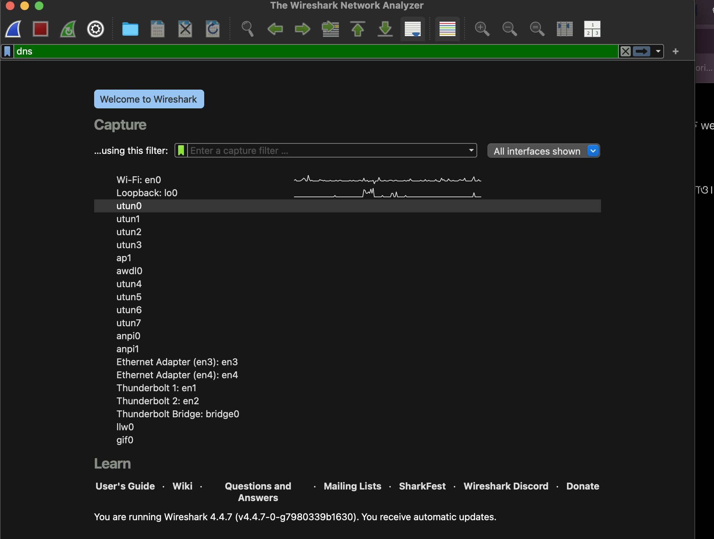
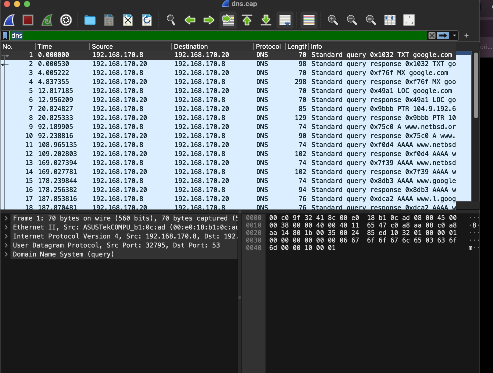
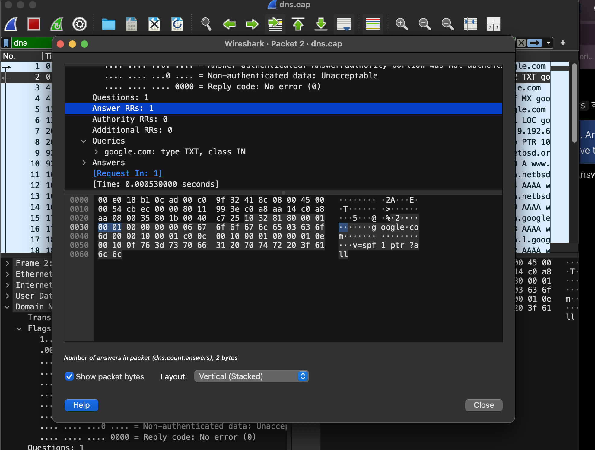
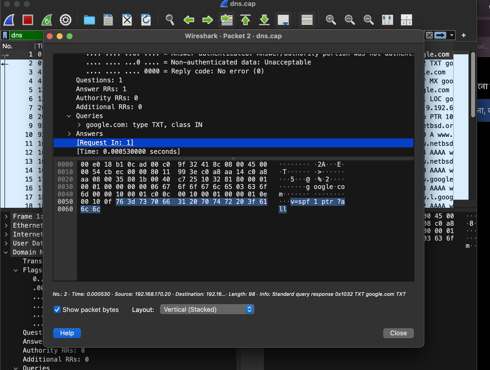
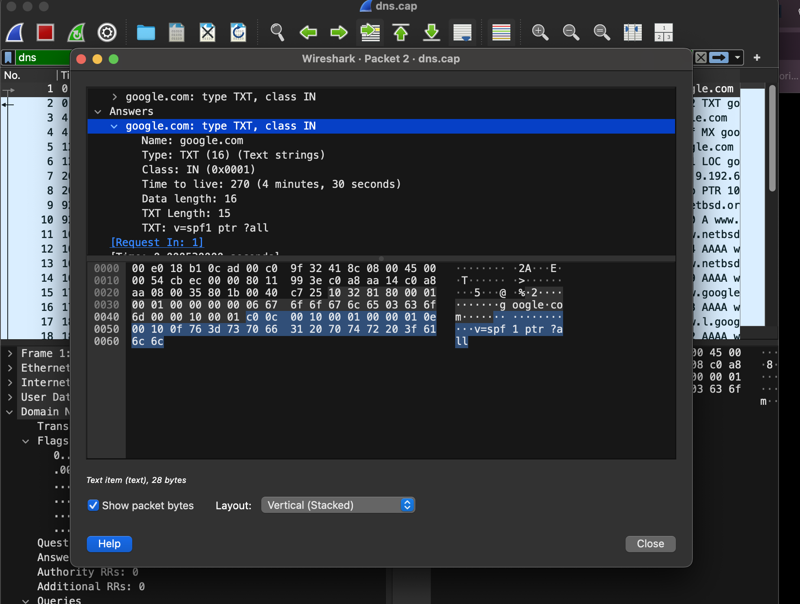
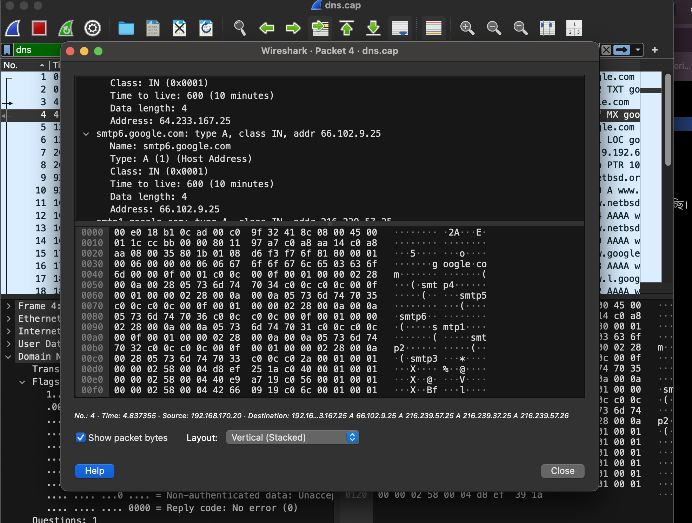

# Case Study 01 — DNS TXT and MX Traffic Analysis

**Project:** Network Signal Intelligence Threat Hunt Lab  
**Investigation date:** 11 November 2026  
**Analyst workflow:** Wireshark packet inspection using an educational sample capture  
**Status:** Initial case analysis complete; wider threat hunt remains in progress

## Executive summary

Inspected the `dns.cap` training capture in Wireshark, applied the `dns` display filter, paired DNS requests and replies, and examined the TXT and MX answers for `google.com`. Packet 2 returned an SPF-related TXT string (`v=spf1 ptr ?all`). Packet 4 provided MX information and accompanying address records. The inspected packets do not themselves demonstrate DNS tunnelling, malware communication, or exfiltration. **This is a narrow packet-level observation, not a clean verdict on the full capture.**

## Scope, tools and provenance

- Tool: Wireshark 4.4.7 on macOS (as seen in the supplied screenshots)
- File: `dns.cap` obtained from the Wireshark Sample Captures page: https://wiki.wireshark.org/SampleCaptures
- Display filter: `dns`
- Dataset SHA-256, complete capture duration and packet count: not independently recorded
- Evidence: analyst screenshots from the guided session; original image files are retained separately until screenshot upload is completed

## Reproducible procedure

1. Open Wireshark and select **File → Open**, then load `dns.cap`.
2. Enter `dns` into the **Display Filter** field and apply it.
3. Select **packet 1**, expand **Domain Name System (query) → Queries**, and inspect `google.com`, TXT, IN, with transaction ID `0x1032`.
4. Select **packet 2**, expand **Domain Name System (response) → Answers → google.com: type TXT, class IN**; note the returned TXT string, TTL and response linkage.
5. Select **packet 3**, confirm the MX query for `google.com` and the cross-reference **Response In: 4**.
6. Select **packet 4**, open **Domain Name System (response)** and inspect MX answers. The guided review identified `smtp4.google.com` with preference 40; a later screenshot also shows accompanying address-record information for `smtp6.google.com`.
7. Record only observed values, explain ordinary protocol use, and reserve judgement on maliciousness pending broader traffic inspection.

## Findings

| ID | Packet(s) | Verified observation | Assessment |
| --- | --- | --- | --- |
| DNS-01 | 1 → 2 | Client `192.168.170.8` queried DNS peer `192.168.170.20` for `google.com` TXT; transaction `0x1032`. Reply returns one answer and a no-error code. | Normal DNS request/response behaviour; not independently suspicious. |
| DNS-02 | 2 | TXT answer: `v=spf1 ptr ?all`; class IN; TTL 270 s; TXT length 15 bytes; data length 16 bytes. Displayed request-to-response interval **0.000530 s (0.53 ms)**. | SPF policy text. The `ptr` mechanism warrants configuration-context review, but is **not** evidence of an attack. |
| DNS-03 | 3 → 4 | MX lookup for `google.com`; packet 3 references packet 4 as response. Analyst read **preference 40** and **`smtp4.google.com`** in the MX answer. | Mail-routing configuration lookup; not inherently suspicious. |
| DNS-04 | 4 | Screenshot shows address record `smtp6.google.com` → `66.102.9.25`, type A, TTL 600 s. Another visible address record value is `64.233.167.25` but its name is not fully visible. | Ancillary DNS answer data. No independent malicious attribution. |

**Important distinction:** The TXT and MX records reflect the historical sample capture only; they are not claims about Google's current live DNS configuration.

## Evidence walkthrough (screenshots supplied during session)

| Step | Screenshot captured | What is shown |
| --- | --- | --- |
| E01 | Wireshark welcome screen | Valid green `dns` filter; interface list; no file yet opened |
| E02 | `dns.cap` packet list | DNS query/response pairs with Source, Destination, Time, Protocol and Info columns |
| E03 | Packet 2 details | DNS response, one answer, no error, request in packet 1, response timing |
| E04 | Packet 2 follow-up | `Answers` section location and record bytes |
| E05 | Packet 2 expanded TXT answer | `google.com`, TXT, TTL 270, `v=spf1 ptr ?all` |
| E06 | Packet 4 expanded DNS details | MX-related DNS answer and address record for `smtp6.google.com` |

## Evidence screenshots

All six screenshots below were uploaded to the `evidence/` directory. They document the guided workflow, rather than a comprehensive analysis of every packet.

### E01 — Display filter at Wireshark welcome screen

### E02 — Loaded DNS capture and packet list

### E03 — DNS response summary

### E04 — Navigating to DNS TXT answers

### E05 — Expanded TXT answer and SPF string

### E06 — MX response and associated address records

## Hypothesis and interpretation

**Hypothesis:** DNS requests involving TXT records might represent suspicious tunnelling or C2 use.

**Observed evidence:** One ordinary TXT response containing an SPF policy and a separate mail-exchanger lookup. No corroborating signs of tunnelling (such as high-volume encoded subdomains, unusual cadence, or long recurring TXT payloads) were established in the examined packets.

**Result:** Hypothesis **not supported by the limited reviewed evidence**; further investigation is required before classifying the full dataset.

## Candidate IOCs

None confirmed from the reviewed packets. Do not label the observed IP addresses or mail hosts as malicious solely because they appear in a DNS capture.

## Limitations and next steps

- No full-capture baseline, domain-frequency analysis or temporal hunting was performed.
- No independent reputation or enrichment check was completed.
- Screenshot evidence covers selected portions of the packet details, not the full capture.
- Record hashes and capture provenance should be completed before publication as a reproducible dataset.
- Next: investigate NXDOMAIN patterns, TXT-query frequency, unusually long subdomains and other traffic; subsequently analyse a separately authorised HTTP training capture.

## Conclusion

The completed initial lab demonstrates DNS protocol literacy, Wireshark filter use, request/response correlation, interpretation of TXT/SPF and MX records, and evidence-based SOC reporting. The examined DNS traffic has **no confirmed indicator of compromise**; that statement is restricted to the packets reviewed.
