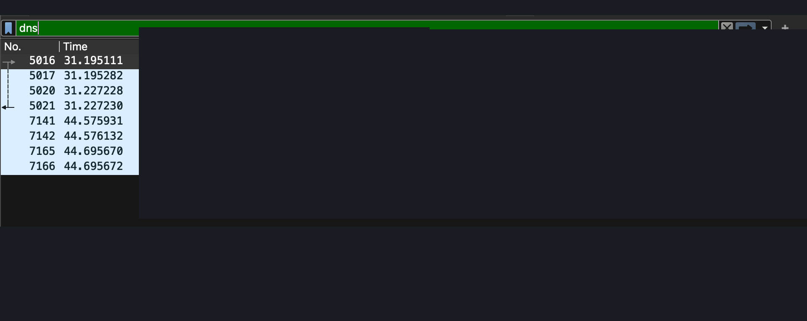
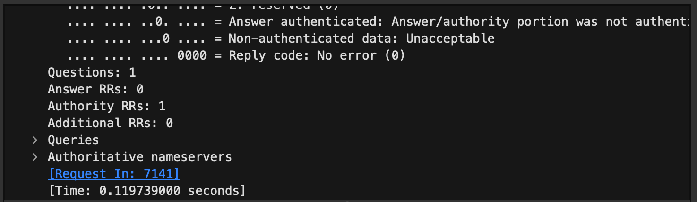
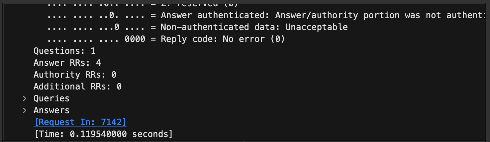
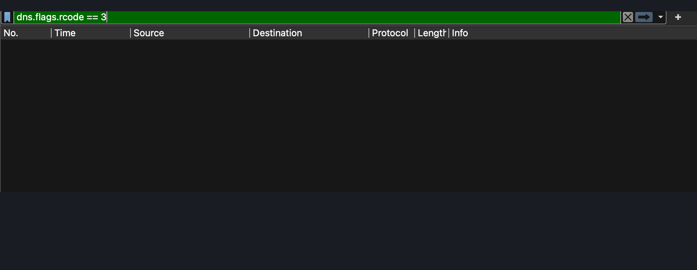
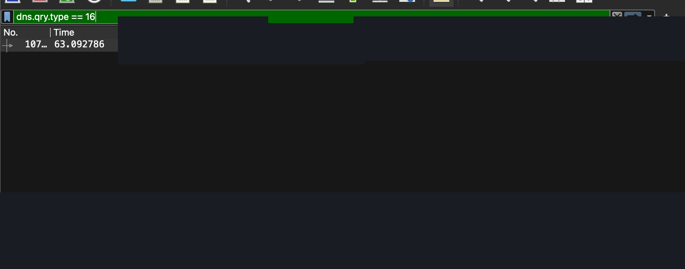

# Case Study 02 — Live Network DNS Traffic Investigation

**Project:** Network Signal Intelligence Threat Hunt Lab  
**Investigation date:** 11 November 2026  
**Environment:** macOS MacBook Air M3, Wireshark, live capture on Wi-Fi interface `en0`  
**Capture:** `live-network-dns-analysis.pcapng` (stored privately, **not published**)  
**Status:** Completed scoped DNS triage; no full-network security certification

## Executive summary

Captured authorised traffic from the analyst's own Wi-Fi interface and reviewed DNS/mDNS activity in Wireshark. The selected DNS responses showed successful protocol status, with observed request-to-response times of approximately 119.7 ms and 119.5 ms. No NXDOMAIN responses and no conventional UDP/53 TXT queries matched the filters used in the saved capture. One TXT query appeared under mDNS on UDP/5353, consistent with local service discovery. **No confirmed indicators of compromise were identified in the inspected subset.** This does not rule out threats outside the capture or encrypted DNS traffic.

The source capture, device names and raw screenshots have intentionally **not** been published to protect personal network metadata.

## Scope and methodology

1. Closed the previous training capture and started **Capture → Wi-Fi: en0**.
2. Applied `dns` to view DNS dissections while live traffic was recorded.
3. Stopped capture and saved the original data locally as `live-network-dns-analysis.pcapng`.
4. Displayed DNS/mDNS responses with `dns.flags.response == 1`.
5. Inspected a conventional DNS **HTTPS record response** (frame **7165**, request **7141**) and an **A record response** (frame **7166**, request **7142**) to the same application API domain.
6. Tested failed-lookups with `dns.flags.rcode == 3`.
7. Tested TXT questions with `dns.qry.type == 16`; identified a local mDNS TXT query.
8. Excluded mDNS and restricted to conventional UDP DNS TXT queries with `dns.qry.type == 16 && dns.flags.response == 0 && udp.port == 53`.
9. Enumerated conventional UDP DNS questions with `dns.flags.response == 0 && udp.port == 53`.

> Privacy note: Internal addresses, personal hostnames and individual application domains are omitted or generalised in the public case study. The complete raw PCAP remains private.

## Findings

| ID | Evidence | Observation | Interpretation |
| --- | --- | --- | --- |
| LIVE-01 | Frame 7165, linked to request 7141 | DNS HTTPS RR query response; flags `0x8180`, RCODE 0 (no error); 0 Answer RRs, 1 Authority RR; elapsed **0.119739 s** (**119.739 ms**). | Successful DNS protocol response, but **no direct HTTPS RR answer**. Not an attack signal by itself. |
| LIVE-02 | Frame 7166, linked to request 7142 | DNS A RR response; flags `0x8180`, RCODE 0; **4 A answers**; elapsed **0.119540 s** (**119.540 ms**). | Ordinary IPv4 resolution with multiple addresses; not inherently malicious. |
| LIVE-03 | `dns.flags.rcode == 3` | No matching packets in the saved capture. | No observed NXDOMAIN responses with this display filter; does not prove the network is clean. |
| LIVE-04 | `dns.qry.type == 16` | One matching TXT question appeared as **mDNS** on UDP/5353 associated with local device/service discovery. | Not sufficient evidence of DNS tunnelling. |
| LIVE-05 | `dns.qry.type == 16 && dns.flags.response == 0 && udp.port == 53` | No matching packets. | No conventional UDP/53 TXT queries observed in this capture under this filter. |
| LIVE-06 | `dns.flags.response == 0 && udp.port == 53` | Six visible standard DNS requests: three domain groups, each with HTTPS (type 65) and A (type 1) requests, sent to a public recursive resolver. | Small observed sample of ordinary DNS lookups; not sufficient for comprehensive attribution. |

**Latency comparison:** 119.739 ms minus 119.540 ms = **0.199 ms**. The timings are measurements of two separate DNS questions; the small difference is not proof of network health or maliciousness.

## Investigation hypotheses and outcomes

- **High NXDOMAIN/error rate:** not observed in this recording using the NXDOMAIN filter.
- **TXT-based DNS tunnelling:** no conventional UDP/53 TXT queries were observed; one mDNS TXT question is not evidence of tunnelling.
- **Unusual queried domains:** no clear encoded/long-subdomain pattern was identified among the six visible conventional DNS queries. This is an initial visual review rather than a domain reputation assessment.

**Assessment:** No confirmed IOC in the reviewed traffic. **Confidence is limited** because inspection was confined to select packets and a small set of filters.

## Redacted screenshot evidence

The following screenshots document the investigation workflow. Personal device names, local network identifiers and sensitive raw bytes were redacted before publication.

### 1. Live DNS traffic

### 2. HTTPS DNS response

### 3. A record DNS response

### 4. NXDOMAIN filter check

### 5. mDNS TXT record check

## Evidence handling

The original live screenshot set was examined during the guided lab and is not published. **Only the five privacy-redacted evidence screenshots linked above are published.** The raw PCAP and unredacted screenshots remain private. Redaction lowers disclosure risk but cannot guarantee that all contextual metadata is non-identifying.

## Limitations

- No full PCAP processing, packet count audit, statistical domain-frequency baseline, reputation enrichment, TLS inspection, endpoint telemetry, or cross-host validation.
- The UDP/53 queries filter excludes mDNS, TCP/53 and DNS-over-HTTPS or DNS-over-TLS.
- A capture from a single Mac Wi-Fi interface does not reveal every device's network traffic.
- A DNS NOERROR response can still contain no matching requested record, as demonstrated by frame 7165.
- The above observations do not establish an absence of compromise.

## Conclusion

This completed **scoped live DNS triage lab** demonstrates capture management, filtering, response correlation, response-code interpretation, comparative latency analysis and elementary DNS threat-hunting checks. The examined evidence is consistent with routine DNS and local service discovery, with **no confirmed suspicious DNS indicators in the selected data**. The public case study documents methodology and findings without publishing personal capture contents.

## Recommended follow-on work

For deeper network threat hunting, use an explicitly authorised or sanitised dataset and analyse DNS query frequency, entropy/length, periodic beaconing, TCP/TLS flow metadata, HTTP transactions where visible, and endpoint security logs. Document findings only where supported by packet-level evidence.
